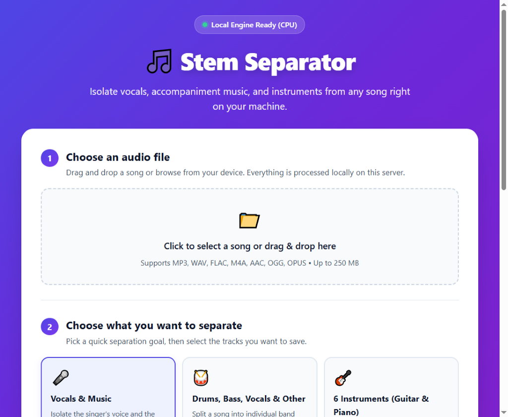
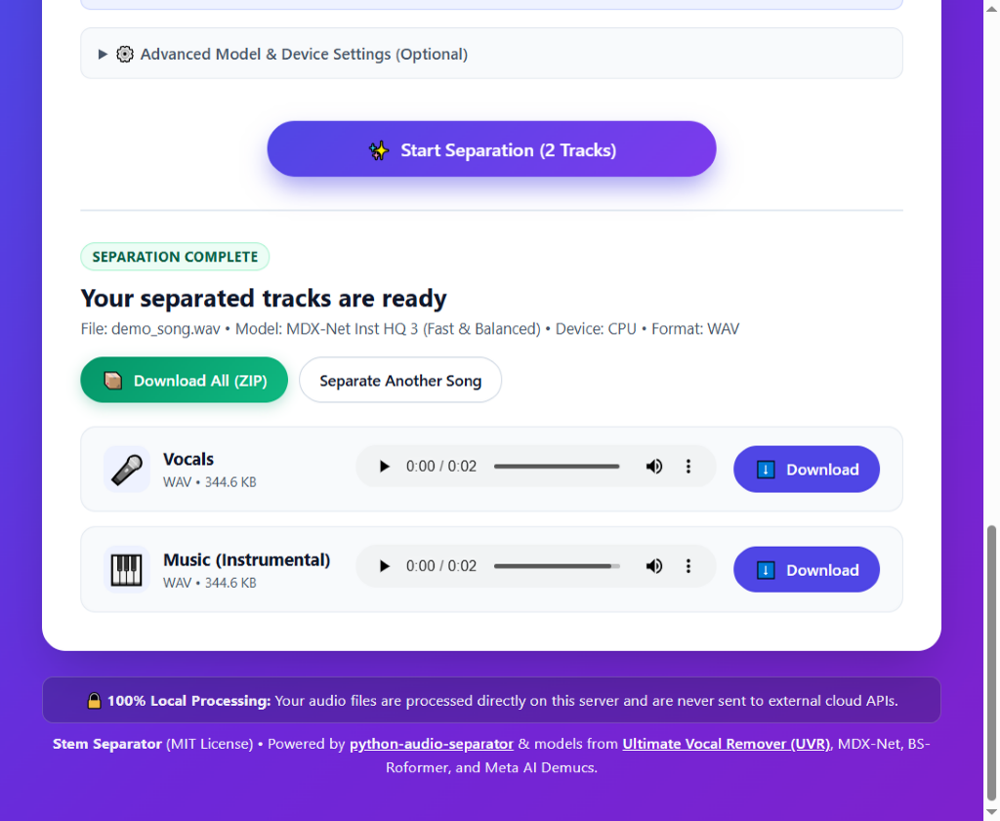

# Stem Separator — AI Audio Separation for Vocals, Music & Instruments

[](LICENSE)
[](https://github.com/nomadkaraoke/python-audio-separator)
[](#docker-installation-recommended)

📖 **[Leia em Português do Brasil (README_PT-BR.md)](README_PT-BR.md)**

**Stem Separator** is a lightweight, self-hosted web application that lets anyone separate **vocals**, **background music (instrumental)**, **drums**, **bass**, **guitar**, **piano**, and **other instruments** from audio files using artificial intelligence—directly on your own computer, homelab, or NAS.

Designed around simplicity and reliability, it requires zero knowledge of AI models or music production: choose a song, pick what you want to isolate, watch real processing stages, listen to the isolated tracks right in your browser, and download individual files or a complete ZIP archive.

---

## ✨ Features

- **Simple, Plain-English Interface:** Choose between clear goals like *Vocals & Music*, *Drums, Bass, Vocals & Other*, or *6 Instruments (with Guitar & Piano)*. No confusing technical jargon required.
- **Powered by [`python-audio-separator`](https://github.com/nomadkaraoke/python-audio-separator):** Solid, isolated integration with curated, SHA-256-verified models from the Ultimate Vocal Remover (UVR), MDX-Net, BS-Roformer, and Demucs v4 ecosystems.
- **Honest Track Filtering:** Only shows output tracks that the selected model can actually produce.
- **In-Page Audio Preview & ZIP Export:** Listen to every separated track with built-in HTML5 audio players before downloading individual files or a single `.zip` bundle.
- **Lossless & Lossy Output Formats:** Export tracks as **WAV (Lossless)**, **FLAC (Lossless Compressed)**, or **MP3 (320 kbps)** while preserving mono/stereo channel counts and sample rates.
- **Background Processing & Real Stages:** Non-blocking job queue with factual stage updates (*Preparing audio* → *Loading AI model* → *Separating tracks* → *Exporting files*), bounded concurrency (`MAX_CONCURRENT_JOBS=1` default) to protect RAM/VRAM, and automatic startup recovery after server restarts.
- **Actionable Error Handling:** Clear, plain-English explanations and one-click recovery suggestions for unsupported files, low disk space, model download problems, or GPU memory limits—without exposing raw stack traces.
- **Ready for CPU & NVIDIA GPU:** Clean Docker Compose setup for CPU out of the box, plus a dedicated Compose override (`docker-compose.gpu.yml`) for NVIDIA CUDA acceleration.

---

## 📸 Screenshots

### Main Interface — Choose a Song & Separation Goal


### Separation Complete — In-Page Audio Players & ZIP Download


---

## 🐳 Docker Installation (Recommended)

Both CPU and NVIDIA GPU setups run the exact same web application on port `7860` and persist downloaded AI models (`/data/models`) and separated results (`/data/output`) outside the container lifecycle.

### Option A: CPU (Default — Works on Any Machine or NAS)

```bash
git clone https://github.com/paladini/stem-separator.git
cd stem-separator
docker compose up -d --build
```

Open **[http://localhost:7860](http://localhost:7860)** in your browser.

### Option B: NVIDIA GPU (CUDA Acceleration)

#### Host Prerequisites for NVIDIA GPU
1. An NVIDIA GPU with updated NVIDIA drivers installed on the host.
2. [NVIDIA Container Toolkit](https://docs.nvidia.com/datacenter/cloud-native/container-toolkit/latest/install-guide.html) installed and configured so Docker can access `--gpus all`.
3. Verify GPU access in Docker before starting:
   ```bash
   docker run --rm --gpus all nvidia/cuda:12.6.3-base-ubuntu22.04 nvidia-smi
   ```

#### Start with the GPU Compose Override
Use `docker-compose.gpu.yml` together with `docker-compose.yml`. This upgrades the single `stem-separator` service in place so CPU and GPU containers never collide on port `7860`:

```bash
docker compose -f docker-compose.yml -f docker-compose.gpu.yml up -d --build
```

Open **[http://localhost:7860](http://localhost:7860)**. The top badge in the UI will confirm `GPU Ready: <Your NVIDIA GPU>`.

---

## 💾 Persistence of Models & Results

`docker-compose.yml` configures two persistent mounts:

| Container Path | Host / Volume Mapping | Purpose |
| --- | --- | --- |
| `/data/models` | Named Docker volume `stem-separator-models` | Stores downloaded AI model weights (`AUDIO_SEPARATOR_MODEL_DIR`) so models are downloaded only once on first use |
| `/data/output` | Bind mount `./data/output` | Stores per-job state (`job.json`), separated tracks (`tracks/`), and `.zip` packages (`STEM_SEPARATOR_OUTPUT_DIR`) |

### Updating & Managing Containers

```bash
# View container health and logs
docker compose ps
docker compose logs -f

# Rebuild / update after pulling new code (CPU)
docker compose up -d --build

# Rebuild / update after pulling new code (NVIDIA GPU)
docker compose -f docker-compose.yml -f docker-compose.gpu.yml up -d --build

# Stop the application (preserves cached models and output files)
docker compose down
```

---

## 🧠 Curated Models & Capabilities

Users do not need to pick technical model names—the application automatically selects tested defaults. Power users can open **Advanced Model & Device Settings** to pick any model from the verified catalog:

| Goal / Mode | Model ID | Friendly Name | Engine Filename | Outputs | Download Size | Recommended Device |
| --- | --- | --- | --- | --- | --- | --- |
| **Vocals & Music** *(Default)* | `vocals_music_fast` | MDX-Net Inst HQ 3 | `UVR-MDX-NET-Inst_HQ_3.onnx` | `vocals`, `music` | ~63.7 MB | CPU & GPU |
| **Vocals & Music** *(Karaoke)* | `vocals_karaoke` | MDX-Net Karaoke 2 | `UVR_MDXNET_KARA_2.onnx` | `vocals`, `music` | ~50.3 MB | CPU & GPU |
| **Vocals & Music** *(Studio HQ)* | `vocals_music_hq` | BS-Roformer Viperx 1297 | `model_bs_roformer_ep_317_sdr_12.9755.ckpt` | `vocals`, `music` | ~609.7 MB | NVIDIA GPU (slow on CPU) |
| **Drums, Bass, Vocals & Other** | `instruments_4` | Demucs v4 Hybrid Transformer | `htdemucs.yaml` | `vocals`, `drums`, `bass`, `other`, `music`* | ~80.2 MB | CPU & GPU |
| **6 Instruments (Guitar & Piano)** | `instruments_6` | Demucs v4 6-Source | `htdemucs_6s.yaml` | `vocals`, `drums`, `bass`, `guitar`, `piano`, `other` | ~53.0 MB | CPU & GPU |

*\*For 4-track Demucs v4 (`htdemucs.yaml`), when `Music (Instrumental)` is checked alongside individual instruments, Stem Separator synthesizes the full instrumental accompaniment by combining `drums + bass + other` without clipping.*

---

## ⚙️ Environment Variables

You can customize resource limits and retention in `docker-compose.yml` or your shell environment:

| Variable | Default | Description |
| --- | --- | --- |
| `AUDIO_SEPARATOR_MODEL_DIR` | `./data/models` (`/data/models` in Docker) | Directory where model weights and YAML configs are cached |
| `STEM_SEPARATOR_OUTPUT_DIR` | `./data/output` (`/data/output` in Docker) | Directory where active and completed job folders are stored |
| `STEM_SEPARATOR_MAX_UPLOAD_MB` | `250` | Maximum allowed audio upload file size in megabytes |
| `STEM_SEPARATOR_MAX_DURATION_MINUTES` | `30` | Maximum allowed audio track duration in minutes |
| `STEM_SEPARATOR_MIN_FREE_DISK_MB` | `500` | Minimum required free disk space (MB) before accepting a new job |
| `STEM_SEPARATOR_MAX_CONCURRENT_JOBS` | `1` | Number of separation jobs processed simultaneously |
| `STEM_SEPARATOR_MAX_QUEUE_SIZE` | `5` | Maximum number of pending jobs allowed in the waiting queue |
| `STEM_SEPARATOR_JOB_RETENTION_HOURS` | `24` | Hours to keep completed/failed job folders before automatic cleanup |
| `STEM_SEPARATOR_PORT` | `7860` | HTTP server port |

---

## 📋 Requirements, Formats & Known Limitations

- **Supported Input Formats:** MP3, WAV, FLAC, M4A, AAC, OGG, OPUS.
- **Supported Output Formats:** WAV (Lossless PCM), FLAC (Lossless Compressed), MP3 (320 kbps).
- **Mono & Stereo Preservation:** Mono (1-channel) uploads are exported as 1-channel tracks; stereo (2-channel) uploads are exported as 2-channel tracks.
- **System Requirements:**
  - **FFmpeg** (including `ffprobe`) must be installed on the system (bundled automatically inside the Docker images).
  - **RAM:** At least 4 GB of free RAM recommended for MDX-Net and Demucs v4; 8 GB+ RAM or an NVIDIA GPU with 6 GB+ VRAM recommended for `BS-Roformer Viperx 1297`.
- **Honest Hardware Acceleration Scope:**
  - **Docker:** Only **CPU** (`Dockerfile`) and **NVIDIA CUDA GPU** (`Dockerfile.gpu` with NVIDIA Container Toolkit) are supported for Docker deployments.
  - **Other Accelerators (Apple Silicon MPS/CoreML, AMD ROCm, Intel/Windows DirectML):** Linux Docker containers on macOS do not pass through Apple Silicon Metal/CoreML, and AMD/Intel GPU pass-through is not verified in these Docker images. If you run on macOS with Apple Silicon and want MPS/CoreML acceleration, run the application natively with Python rather than inside Docker.
  - **6-Instrument Model (`htdemucs_6s.yaml`):** Per the upstream Demucs v4 author notes, the `guitar` and `piano` tracks are more experimental than the 4-track `htdemucs.yaml` model and may exhibit occasional bleed depending on the mix.

---

## 🔒 Security, Privacy & Local Network Guidance

- **100% Local Processing:** All audio decoding, AI model inference, and file exports happen on the machine where Stem Separator is hosted. Your songs are never uploaded to third-party separation APIs.
- **File & Directory Isolation:** User filenames are sanitized on upload, no shell commands are ever constructed from user strings, each job writes to an isolated UUID directory, and file download endpoints enforce strict path containment.
- **Network Exposure Warning:** Stem Separator is designed for personal use, homelabs, and trusted local networks (LAN). It does **not** include built-in user authentication or per-IP rate limiting. Before exposing the service to the public internet, place it behind a reverse proxy (such as Caddy, Traefik, Nginx, or Cloudflare Access) with HTTPS, authentication, and request size/rate limits.

---

## 🆘 Troubleshooting

- **"Degraded" health check or `FFmpeg not found` (Local Python):**
  Install FFmpeg on your system (`sudo apt-get install ffmpeg` on Ubuntu/Debian, `brew install ffmpeg` on macOS, or `winget install Gyan.FFmpeg` on Windows) and verify `ffmpeg -version` works in your terminal.
- **First separation takes longer than expected:**
  On first use of a model, Stem Separator downloads the model weights (from ~50 MB for `UVR_MDXNET_KARA_2.onnx` up to ~610 MB for `BS-Roformer`). Once saved in `/data/models`, subsequent runs start immediately.
- **Out of memory (RAM or VRAM) error:**
  Switch to the default **Vocals & Music (`MDX-Net Inst HQ 3`)** model (~63.7 MB), which uses very little memory, or select **Force CPU** in *Advanced Model & Device Settings*.
- **NVIDIA GPU not detected inside Docker:**
  Ensure you started the stack with `-f docker-compose.yml -f docker-compose.gpu.yml`, that the host has the NVIDIA driver installed (`nvidia-smi` works on the host), and that `nvidia-ctk` (NVIDIA Container Toolkit) is configured for Docker.

---

## 💻 Local Development & Testing

### Prerequisites
- Python 3.10 – 3.13 (Python 3.12 recommended)
- FFmpeg installed and available on `PATH`

### Run Locally

```bash
# 1. Create and activate a virtual environment
python -m venv .venv
source .venv/bin/activate  # On Windows PowerShell: .\.venv\Scripts\Activate.ps1

# 2. Install dependencies
pip install --upgrade pip
pip install -r requirements.txt

# 3. Start the application
python main.py
```

Open **[http://localhost:7860](http://localhost:7860)**.

### Run the Test Suite

```bash
# Run all unit, API, resilience, and integration tests
pytest -v
```

> **Note on Real Model & GPU Tests:**
> - `tests/test_s4_docker_and_docs.py::test_real_audio_separator_engine_integration` runs a full separation through `python-audio-separator` using `UVR-MDX-NET-Inst_HQ_3.onnx` whenever the model is cached in `data/models/` (or when `STEM_SEPARATOR_RUN_REAL_MODEL_TEST=1` is set).
> - NVIDIA GPU execution paths are validated via configuration and unit tests when no physical NVIDIA GPU is present on the test machine.

---

## 📄 License & Credits

### Project License
The **Stem Separator** source code is licensed under the **[MIT License](LICENSE)**.

### Upstream Engine, Models & Weights Credits
This project builds upon the open-source audio separation community. Please honor the licenses and credits of the underlying libraries and model authors:

- **[`python-audio-separator`](https://github.com/nomadkaraoke/python-audio-separator)** by Andrew Beveridge ([@beveradb](https://github.com/beveradb)) and contributors — MIT License.
- **[Ultimate Vocal Remover (UVR)](https://github.com/Anjok07/ultimatevocalremovergui)** by [@Anjok07](https://github.com/Anjok07) and [@aufr33](https://github.com/aufr33) — MIT License. Model weights `UVR-MDX-NET-Inst_HQ_3.onnx` and `UVR_MDXNET_KARA_2.onnx` are trained and distributed by the UVR project.
- **[MDX-Net](https://github.com/kuielab)** by Kuielab & Woosung Choi — MIT License.
- **[BS-Roformer](https://github.com/lucidrains/BS-RoFormer)** architecture by Phil Wang (`lucidrains`) and model weights `model_bs_roformer_ep_317_sdr_12.9755.ckpt` trained by **ViperX** — MIT License.
- **[Demucs v4 (Hybrid Transformer)](https://github.com/facebookresearch/demucs)** by Alexandre Défossez and Meta AI Research (`htdemucs`, `htdemucs_6s`) — MIT License.
- Inspired by **[Voice Separator (`voice-separator-demucs`)](https://github.com/paladini/voice-separator-demucs)** by Fernando Paladini ([@paladini](https://github.com/paladini)).
