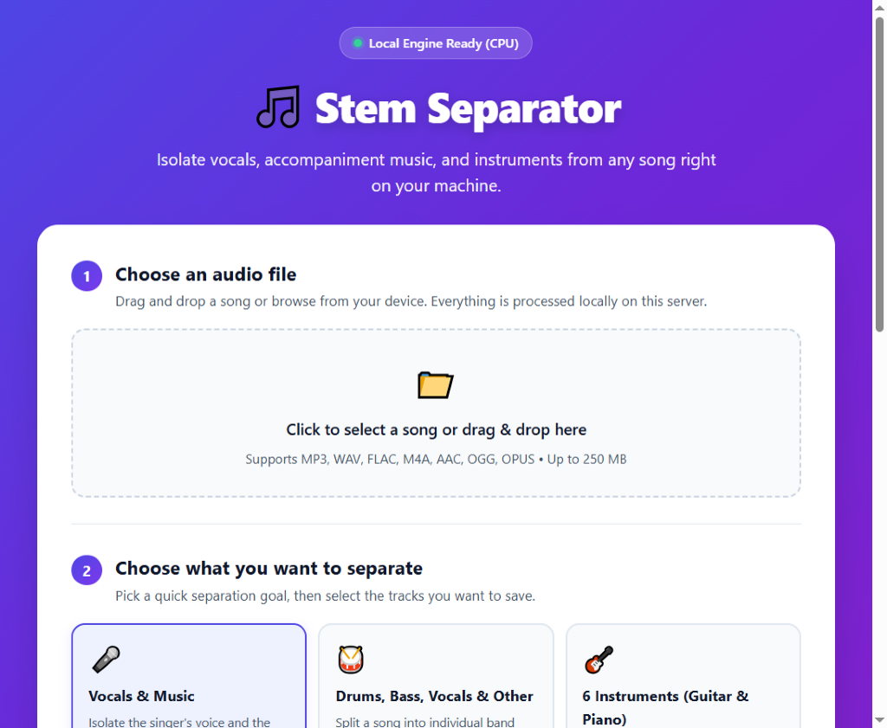
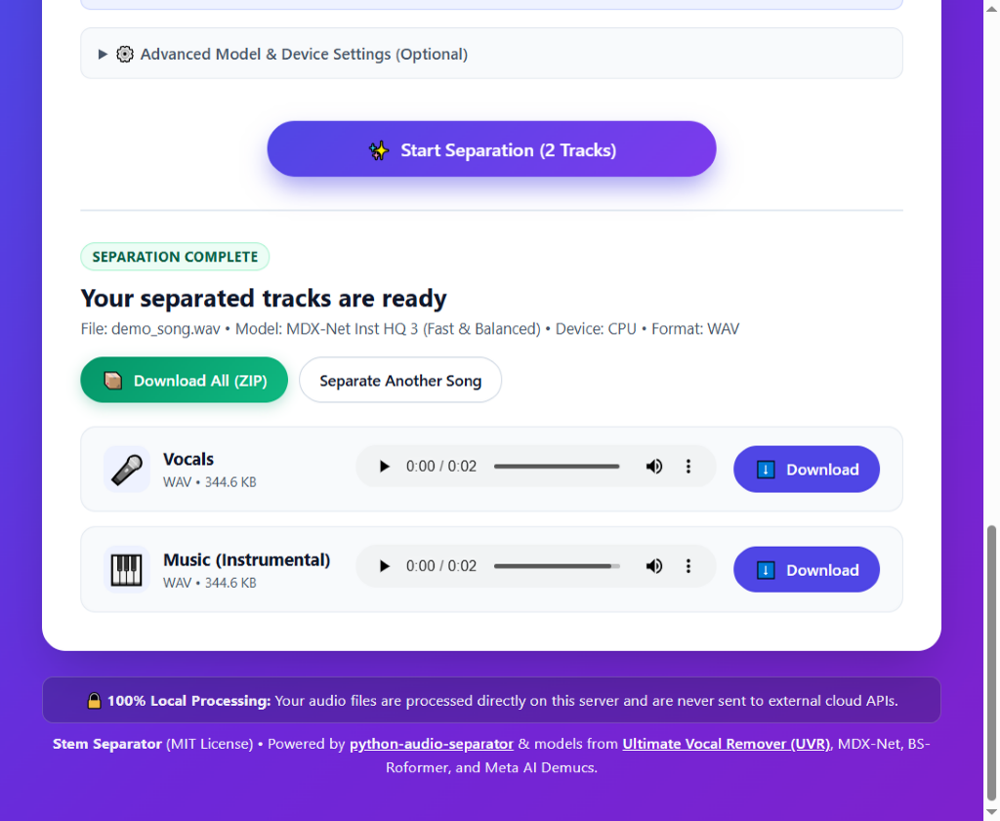

# Stem Separator — Separação de Voz, Música e Instrumentos com IA

[](LICENSE)
[](https://github.com/nomadkaraoke/python-audio-separator)
[](#instala%C3%A7%C3%A3o-com-docker-recomendado)

📖 **[Read in English (README.md)](README.md)**

O **Stem Separator** é uma aplicação web self-hosted, leve, bonita e extremamente fácil de usar que permite a qualquer pessoa separar **voz (vocals)**, **acompanhamento musical (music/instrumental)**, **bateria (drums)**, **baixo (bass)**, **guitarra/violão (guitar)**, **piano** e **outros instrumentos** de arquivos de áudio usando inteligência artificial — diretamente no seu computador, homelab ou NAS.

Projetado com foco em simplicidade e confiabilidade, não exige nenhum conhecimento prévio sobre modelos de IA ou produção musical: basta escolher uma música, selecionar o que deseja separar, acompanhar as etapas reais de processamento, escutar o resultado na própria página e baixar as faixas individualmente ou em um pacote ZIP.

---

## ✨ Funcionalidades

- **Interface Simples e Intuitiva:** Escolha objetivos fáceis de entender, como *Vocals & Music*, *Drums, Bass, Vocals & Other* ou *6 Instruments (with Guitar & Piano)*, sem jargões técnicos desnecessários.
- **Motor Principal [`python-audio-separator`](https://github.com/nomadkaraoke/python-audio-separator):** Integração sólida e isolada em camada própria, utilizando modelos testados e verificados por hash SHA-256 dos ecossistemas Ultimate Vocal Remover (UVR), MDX-Net, BS-Roformer e Demucs v4.
- **Opções de Saída Validadas:** A interface exibe e permite selecionar apenas as faixas que o modelo ativo realmente consegue produzir.
- **Player de Áudio Integrado e Download em ZIP:** Escute cada faixa separada diretamente no navegador antes de baixar os arquivos individuais ou um pacote `.zip` completo.
- **Formatos Sem Perda (Lossless) e Compactos:** Exporte o resultado em **WAV (Lossless)**, **FLAC (Lossless Comprimido)** ou **MP3 (320 kbps)**, preservando canais mono/estéreo e taxas de amostragem.
- **Processamento em Segundo Plano com Etapas Reais:** Fila assíncrona com etapas factuais (*Preparing audio* → *Loading AI model* → *Separating tracks* → *Exporting files*), controle de concorrência (`MAX_CONCURRENT_JOBS=1` por padrão) para proteger RAM/VRAM e recuperação automática caso o servidor seja reiniciado durante um trabalho.
- **Tratamento Explícito de Erros:** Mensagens claras e ações úteis para arquivos corrompidos, falta de espaço em disco, falhas de download de modelo ou limites de memória — sem expor stack traces internos ao usuário final.
- **Pronto para CPU e GPU NVIDIA:** Execução simples com Docker Compose para CPU e arquivo de override dedicado (`docker-compose.gpu.yml`) para aceleração CUDA em GPUs NVIDIA.

---

## 📸 Capturas de Tela

### Interface Principal — Seleção de Música e Objetivo de Separação


### Separação Concluída — Players de Áudio na Página e Download ZIP


---

## 🐳 Instalação com Docker (Recomendado)

Tanto a opção de CPU quanto a de GPU NVIDIA executam a mesma aplicação na porta `7860` e persistem os modelos baixados (`/data/models`) e os resultados (`/data/output`) fora do ciclo de vida do contêiner.

### Opção A: CPU (Padrão — Funciona em Qualquer Máquina ou NAS)

```bash
git clone https://github.com/paladini/stem-separator.git
cd stem-separator
docker compose up -d --build
```

Acesse **[http://localhost:7860](http://localhost:7860)** no navegador.

### Opção B: GPU NVIDIA (Aceleração CUDA)

#### Pré-requisitos do Host para GPU NVIDIA
1. GPU NVIDIA com drivers atualizados instalados no sistema host.
2. [NVIDIA Container Toolkit](https://docs.nvidia.com/datacenter/cloud-native/container-toolkit/latest/install-guide.html) instalado e configurado no Docker.
3. Verifique se o Docker enxerga sua GPU antes de iniciar:
   ```bash
   docker run --rm --gpus all nvidia/cuda:12.6.3-base-ubuntu22.04 nvidia-smi
   ```

#### Iniciando com o Override de GPU
Use o arquivo `docker-compose.gpu.yml` em conjunto com o `docker-compose.yml`. Isso atualiza o único serviço `stem-separator` para usar GPU sem iniciar dois contêineres disputando a porta `7860`:

```bash
docker compose -f docker-compose.yml -f docker-compose.gpu.yml up -d --build
```

Acesse **[http://localhost:7860](http://localhost:7860)**. O selo no topo da página confirmará `GPU Ready: <Sua GPU NVIDIA>`.

---

## 💾 Persistência de Modelos e Resultados

O `docker-compose.yml` configura dois volumes persistentes:

| Caminho no Contêiner | Mapeamento no Host | Finalidade |
| --- | --- | --- |
| `/data/models` | Volume Docker nomeado `stem-separator-models` | Armazena os pesos dos modelos de IA (`AUDIO_SEPARATOR_MODEL_DIR`) para que cada modelo seja baixado apenas uma vez no primeiro uso |
| `/data/output` | Pasta local `./data/output` | Armazena o estado de cada trabalho (`job.json`), as faixas separadas (`tracks/`) e os pacotes `.zip` (`STEM_SEPARATOR_OUTPUT_DIR`) |

### Atualização e Gerenciamento

```bash
# Verificar status de saúde (healthcheck) e logs
docker compose ps
docker compose logs -f

# Atualizar / reconstruir em modo CPU
docker compose up -d --build

# Atualizar / reconstruir em modo GPU NVIDIA
docker compose -f docker-compose.yml -f docker-compose.gpu.yml up -d --build

# Parar o contêiner (mantém modelos em cache e arquivos gerados)
docker compose down
```

---

## 🧠 Catálogo de Modelos Curados

O usuário não precisa escolher nomes técnicos de modelos — o sistema seleciona padrões testados automaticamente. Usuários avançados podem abrir **Advanced Model & Device Settings** para escolher qualquer modelo do catálogo validado:

| Objetivo / Modo | ID do Modelo | Nome Amigável | Arquivo no Motor | Saídas Produzidas | Tamanho do Download | Dispositivo Recomendado |
| --- | --- | --- | --- | --- | --- | --- |
| **Vocals & Music** *(Padrão)* | `vocals_music_fast` | MDX-Net Inst HQ 3 | `UVR-MDX-NET-Inst_HQ_3.onnx` | `vocals`, `music` | ~63,7 MB | CPU e GPU |
| **Vocals & Music** *(Karaokê)* | `vocals_karaoke` | MDX-Net Karaoke 2 | `UVR_MDXNET_KARA_2.onnx` | `vocals`, `music` | ~50,3 MB | CPU e GPU |
| **Vocals & Music** *(Alta Qualidade)* | `vocals_music_hq` | BS-Roformer Viperx 1297 | `model_bs_roformer_ep_317_sdr_12.9755.ckpt` | `vocals`, `music` | ~609,7 MB | GPU NVIDIA (lento em CPU) |
| **Drums, Bass, Vocals & Other** | `instruments_4` | Demucs v4 Hybrid Transformer | `htdemucs.yaml` | `vocals`, `drums`, `bass`, `other`, `music`* | ~80,2 MB | CPU e GPU |
| **6 Instruments (Guitar & Piano)** | `instruments_6` | Demucs v4 6-Source | `htdemucs_6s.yaml` | `vocals`, `drums`, `bass`, `guitar`, `piano`, `other` | ~53,0 MB | CPU e GPU |

*\*No modelo Demucs v4 de 4 faixas (`htdemucs.yaml`), quando a opção `Music (Instrumental)` também é marcada, o Stem Separator sintetiza a faixa instrumental completa combinando `drums + bass + other` sem distorção (clipping).*

---

## ⚙️ Variáveis de Ambiente

Os limites de recursos e limpeza automática podem ser ajustados no `docker-compose.yml` ou no ambiente:

| Variável | Padrão | Descrição |
| --- | --- | --- |
| `AUDIO_SEPARATOR_MODEL_DIR` | `./data/models` (`/data/models` no Docker) | Diretório onde os modelos baixados ficam em cache persistente |
| `STEM_SEPARATOR_OUTPUT_DIR` | `./data/output` (`/data/output` no Docker) | Diretório onde os trabalhos e arquivos separados são salvos |
| `STEM_SEPARATOR_MAX_UPLOAD_MB` | `250` | Tamanho máximo permitido para upload de arquivo de áudio (MB) |
| `STEM_SEPARATOR_MAX_DURATION_MINUTES` | `30` | Duração máxima permitida para o áudio enviado (minutos) |
| `STEM_SEPARATOR_MIN_FREE_DISK_MB` | `500` | Espaço livre mínimo em disco (MB) exigido antes de aceitar novos trabalhos |
| `STEM_SEPARATOR_MAX_CONCURRENT_JOBS` | `1` | Número máximo de separações executadas simultaneamente |
| `STEM_SEPARATOR_MAX_QUEUE_SIZE` | `5` | Número máximo de trabalhos aguardando na fila |
| `STEM_SEPARATOR_JOB_RETENTION_HOURS` | `24` | Tempo (em horas) para manter resultados antigos antes da limpeza automática |
| `STEM_SEPARATOR_PORT` | `7860` | Porta HTTP do servidor |

---

## 📋 Requisitos, Formatos e Limitações Reais

- **Formatos de Entrada Suportados:** MP3, WAV, FLAC, M4A, AAC, OGG, OPUS.
- **Formatos de Saída Suportados:** WAV (Lossless PCM), FLAC (Lossless Comprimido), MP3 (320 kbps).
- **Preservação de Mono e Estéreo:** Arquivos mono (1 canal) geram saídas mono (1 canal); arquivos estéreo (2 canais) geram saídas estéreo (2 canais).
- **Requisitos de Sistema:**
  - **FFmpeg** (incluindo `ffprobe`) instalado no sistema (já incluído automaticamente nas imagens Docker).
  - **Memória:** Recomendado ao menos 4 GB de RAM livre para MDX-Net e Demucs v4; 8 GB+ de RAM ou GPU NVIDIA com 6 GB+ de VRAM recomendados para o modelo `BS-Roformer Viperx 1297`.
- **Limitações Conhecidas de Hardware e Aceleração:**
  - **Docker:** Apenas **CPU** (`Dockerfile`) e **GPU NVIDIA com CUDA** (`Dockerfile.gpu` + NVIDIA Container Toolkit) são suportados em contêineres Docker.
  - **Outros Dispositivos (Apple Silicon MPS/CoreML, AMD ROCm, Intel/DirectML):** Contêineres Docker Linux no macOS não expõem aceleração Metal/CoreML do Apple Silicon, e GPUs AMD/Intel não possuem aceleração validada nessas imagens Docker. Em Macs com Apple Silicon, execute a aplicação diretamente com Python no host caso deseje aceleração MPS/CoreML.
  - **Modelo de 6 Instrumentos (`htdemucs_6s.yaml`):** Conforme documentado pelos autores do Demucs v4, as faixas `guitar` e `piano` têm caráter mais experimental que o modelo de 4 faixas (`htdemucs.yaml`) e podem apresentar vazamento entre instrumentos dependendo da mixagem original.

---

## 🔒 Segurança, Privacidade e Uso em Rede

- **Processamento 100% Local:** Todo o processamento ocorre na máquina onde o Stem Separator está instalado. Nenhum arquivo de áudio é enviado para serviços externos na nuvem.
- **Isolamento e Validação:** Nomes de arquivos enviados pelo usuário são higienizados, nenhum comando de shell é construído com dados do usuário, cada trabalho utiliza um diretório isolado por UUID e as rotas de download bloqueiam qualquer tentativa de acesso fora da pasta de faixas do trabalho (`path traversal`).
- **Condições de Uso em Rede Local vs. Exposição Pública:** A aplicação foi projetada para uso pessoal, homelabs e redes locais confiáveis (LAN), não possuindo sistema de login ou autenticação multiusuário embutido. Antes de expor a aplicação na internet pública, coloque-a atrás de um proxy reverso (Caddy, Traefik, Nginx ou Cloudflare Access) com HTTPS, autenticação e controle de taxa de requisições (rate limiting).

---

## 🆘 Solução de Problemas (Troubleshooting)

- **Health check "degraded" ou `FFmpeg not found` (Execução local com Python):**
  Instale o FFmpeg no sistema (`sudo apt-get install ffmpeg` no Ubuntu/Debian, `brew install ffmpeg` no macOS ou `winget install Gyan.FFmpeg` no Windows) e confirme que `ffmpeg -version` responde no terminal.
- **A primeira separação demora mais que as seguintes:**
  No primeiro uso de um modelo, o Stem Separator baixa os pesos oficiais (de ~50 MB no `UVR_MDXNET_KARA_2.onnx` até ~610 MB no `BS-Roformer`). Após salvo em `/data/models`, as próximas execuções iniciam imediatamente sem novo download.
- **Erro de falta de memória (RAM ou VRAM):**
  Selecione o modelo padrão **Vocals & Music (`MDX-Net Inst HQ 3`)** (~63,7 MB), que consome pouca memória, ou marque **Force CPU** nas configurações avançadas.
- **GPU NVIDIA não detectada no Docker:**
  Confirme que iniciou com `-f docker-compose.yml -f docker-compose.gpu.yml`, que o driver NVIDIA está ativo no host (`nvidia-smi`) e que o NVIDIA Container Toolkit está configurado.

---

## 💻 Desenvolvimento Local e Testes

### Pré-requisitos
- Python 3.10 a 3.13 (recomendado Python 3.12)
- FFmpeg instalado e disponível no `PATH`

### Executar Localmente

```bash
# 1. Criar e ativar ambiente virtual
python -m venv .venv
source .venv/bin/activate  # No Windows PowerShell: .\.venv\Scripts\Activate.ps1

# 2. Instalar dependências
pip install --upgrade pip
pip install -r requirements.txt

# 3. Iniciar o servidor
python main.py
```

Acesse **[http://localhost:7860](http://localhost:7860)**.

### Executar os Testes Automatizados

```bash
pytest -v
```

> **Nota sobre testes com modelo real e GPU:**
> - O teste `tests/test_s4_docker_and_docs.py::test_real_audio_separator_engine_integration` executa uma separação completa real pelo `python-audio-separator` com o modelo `UVR-MDX-NET-Inst_HQ_3.onnx` sempre que o modelo estiver em cache em `data/models/` (ou quando `STEM_SEPARATOR_RUN_REAL_MODEL_TEST=1` for definido).
> - Quando não há hardware NVIDIA disponível na máquina de teste, a execução GPU é validada por testes de configuração e de unidade, sem declarar o runtime CUDA como testado em hardware físico.

---

## 📄 Licença e Créditos

### Licença do Projeto
O código-fonte do **Stem Separator** é distribuído sob a **[Licença MIT](LICENSE)**.

### Créditos do Motor, Modelos e Pesos
Este projeto utiliza e homenageia o trabalho de código aberto da comunidade de separação de áudio:

- **[`python-audio-separator`](https://github.com/nomadkaraoke/python-audio-separator)** por Andrew Beveridge ([@beveradb](https://github.com/beveradb)) e colaboradores — Licença MIT.
- **[Ultimate Vocal Remover (UVR)](https://github.com/Anjok07/ultimatevocalremovergui)** por [@Anjok07](https://github.com/Anjok07) e [@aufr33](https://github.com/aufr33) — Licença MIT. Os modelos `UVR-MDX-NET-Inst_HQ_3.onnx` e `UVR_MDXNET_KARA_2.onnx` foram treinados e disponibilizados pelo projeto UVR.
- **[MDX-Net](https://github.com/kuielab)** por Kuielab & Woosung Choi — Licença MIT.
- **[BS-Roformer](https://github.com/lucidrains/BS-RoFormer)** por Phil Wang (`lucidrains`) e pesos `model_bs_roformer_ep_317_sdr_12.9755.ckpt` treinados por **ViperX** — Licença MIT.
- **[Demucs v4 (Hybrid Transformer)](https://github.com/facebookresearch/demucs)** por Alexandre Défossez e Meta AI Research (`htdemucs`, `htdemucs_6s`) — Licença MIT.
- Inspirado no projeto **[Voice Separator (`voice-separator-demucs`)](https://github.com/paladini/voice-separator-demucs)** de Fernando Paladini ([@paladini](https://github.com/paladini)).
